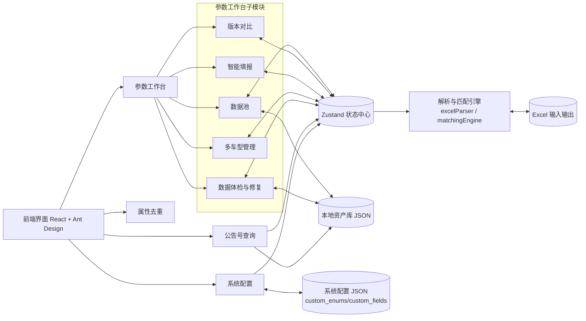
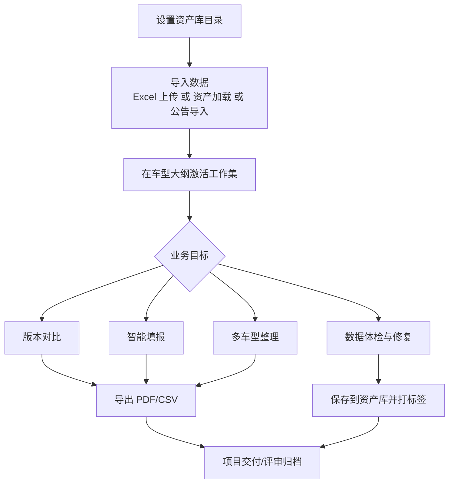

# 智行参数管理系统（Vehicle Parameter Manager）操作手册

版本：`v4.4.5`  
更新日期：`2026-03-04`

---

## 1. 文档目的

本文档用于指导用户在日常业务中完整使用智行参数管理系统，覆盖以下内容：

1. 设计哲学与产品定位
2. 系统信息架构与模块关系
3. 全部功能模块的详细操作步骤
4. 推荐业务流程（从导入到比对到填报到归档）
5. 常见问题与故障排查建议

---

## 2. 设计哲学

系统设计遵循四个核心理念：

### 2.1 单一数据池（Single Source of Truth）

无论数据来源于 Excel 上传、资产库加载，还是公告号导入，最终都汇入统一的数据池（工作台数据池），由各功能模块共享使用。  
目标是避免“同一车型在多个模块重复导入、重复维护”。

### 2.2 低点击与高反馈（Low-Click UX）

系统大量采用自动触发和默认填充策略：

1. 输入后自动防抖计算（如智能填报、多车型整理）
2. 模块间默认继承当前已选车型
3. 常用字段一键导入（系统必填、质量验车）

目标是减少机械重复操作，提升分析连贯性。

### 2.3 人机协同而非黑盒自动化（Human-in-the-Loop）

系统会自动匹配、自动比对、自动识别异常，但核心结果均支持人工校正和回写。  
目标是“先自动给答案，再人工校正确认”，兼顾效率与可控性。

### 2.4 资产化沉淀（Data as Asset）

经过清洗和确认的数据可保存为资产（JSON），支持标签、检索、复用、覆盖更新。  
目标是让一次处理结果长期可复用，而不是每次从头导入和清理。

---

## 3. 界面结构与模块总览

## 3.1 顶部主导航

系统一级菜单包括：

1. 参数工作台
2. 公告号查询
3. 系统配置
4. 属性去重

右上角全局操作：

1. 亮/暗主题切换
2. 资产库目录设置
3. 清除缓存并重置系统

## 3.2 参数工作台（核心）

工作台内含 5 个子模块：

1. 数据池
2. 版本对比
3. 智能填报
4. 多车型管理
5. 数据体检与修复

## 3.3 架构图与流程图

### 3.3.1 系统架构图（逻辑视图）

### 3.3.2 主业务流程图（推荐作业流）

---

## 4. 快速上手（建议首次使用按此顺序）

1. 点击右上角设置按钮，配置“资产库目录”。
2. 进入“参数工作台 > 数据池”，上传 1~N 个 Excel 文件。
3. 在车型大纲中勾选本次分析的车型（形成工作集）。
4. 打开“版本对比”查看差异。
5. 打开“智能填报”生成需求填报值。
6. 打开“数据体检与修复”修正字段名/枚举值后保存到资产库。

---

## 5. 全局功能操作说明

## 5.1 设置资产库目录

用途：启用资产持久化、资产加载、系统配置文件读写。

步骤：

1. 点击右上角齿轮按钮。
2. 选择一个本地目录（建议专用目录，如 `D:\VehicleAssets`）。
3. 设置成功后会提示目录路径。

建议：

1. 不要设置到同步盘临时目录或系统受限目录。
2. 团队协作时建议使用统一命名规则。

## 5.2 清除缓存并重置系统

用途：彻底清空本地状态（工作集、选择状态、界面偏好等）。

步骤：

1. 点击右上角删除图标。
2. 阅读确认弹窗说明。
3. 点击“立即重置”。

注意：

1. 此操作不可恢复。
2. 该操作清理的是应用缓存状态，不会主动删除你资产库目录中的 JSON 资产文件。

---

## 6. 参数工作台详细操作

## 6.1 数据池

数据池是系统中最重要的入口，负责数据引入、工作集组织和预览。

说明：

1. 参数工作台已采用紧凑布局，去除了装饰性副标题和部分冗余留白，以便同屏展示更多业务信息。

界面由三列构成：

1. 左列：数据源与资产库
2. 中列：车型大纲（工作集）
3. 右列：焦点车型概览

### 6.1.1 左列：工作区文件操作（Excel）

入口：左列“工作区 (Excel)”。

支持操作：

1. 添加文件（`.xlsx/.xls`）
2. 重命名文件
3. 删除文件
4. 清空全部工作区文件
5. 重新配置解析（手动解析流程）
6. 打开“我的资产库”抽屉

#### 上传文件步骤

1. 点击“添加文件”。
2. 选择 Excel 文件（可多选）。
3. 系统自动解析并加入数据池。

若自动解析失败：

1. 系统会自动弹出解析预览窗口。
2. 你可以手动配置表头行、数据起始行、产品列等解析参数。
3. 确认后按配置解析并加入数据池。

### 6.1.2 左列：资产库区域（Assets）

前提：必须已设置资产库目录。

布局能力：

1. 数据池页面支持左右主分栏拖拽。
2. 左列内部支持上下分栏拖拽：
   1. 上方是 Excel 工作区
   2. 下方是资产库
3. 调整后的布局会自动记住，下次打开仍保持。
4. 资产库标题区支持“恢复布局”，可一键回到默认尺寸。

支持操作：

1. 查看资产列表（含参数数、填报率）
2. 搜索资产（文件名/车型/标签）
3. 资产激活/停用（进入/移出工作集）
4. 资产重命名
5. 资产删除
6. 资产导出 CSV
7. 资产升级导入（用新版 Excel 对现有资产做覆盖审查）
8. 标签过滤（多标签交集）
9. 按标签批量激活资产

筛选规则说明：

1. 资产库筛选已拆分为：
   1. 来源
   2. 车型族群
   3. 厂商
   4. 其他标签
2. 其中：
   1. 车型族群为单选互斥
   2. 厂商为单选互斥
   3. 其他标签为多选交集
3. 这样可避免类似 `大面 + 小卡` 这类互斥筛选同时成立。

激活逻辑：

1. 激活资产后，资产车型会自动进入“待分析车型大纲”。
2. 停用资产后，会同步从相关工作集选择中移除。

命名规则说明：

1. 资产卡片现在只维护一个名称。
2. 当你执行“重命名资产”时，系统会同时：
   1. 更新资产文件名基名
   2. 更新资产内部车型名称
3. 卡片标题默认不再显示 `.json` 后缀。

### 6.1.2.1 资产升级导入

适用场景：

1. 资产库里已经有一份人工维护过的车型资产。
2. 厂商后来又给了一份新版 Excel。
3. 你希望保留旧资产里的人工修复结果，同时把新版中有价值的更新安全合并进来。

入口位置：

1. 打开“参数工作台 > 数据池”。
2. 在左下角“资产库区域”找到目标资产卡片。
3. 点击卡片操作区中的“升级导入”按钮。

操作步骤：

1. 系统先加载该资产作为“基线资产”。
2. 点击“导入新版 Excel”，上传厂商新文件。
3. 若自动解析失败，系统会自动弹出 Excel 预览配置窗口，你可手动指定表头、产品列和起始行。
4. 解析成功后，系统会生成升级清单，并把字段分为：
   1. 一致
   2. 新增字段
   3. 空值补全
   4. 冲突字段
   5. 仅旧资产存在
5. 默认处理策略：
   1. 新增字段：默认使用新版
   2. 空值补全：默认使用新版
   3. 仅旧资产存在：默认保留旧值
   4. 一致：默认保留旧值
   5. 冲突字段：默认“稍后处理”，必须人工决策
6. 在清单里逐项处理冲突字段：
   1. 保留旧值
   2. 使用新版
   3. 稍后处理
7. 在“最终覆盖预览”区域先看摘要：
   1. 使用新版多少项
   2. 保留旧值多少项
   3. 实际发生变更多少项
   4. 仍有多少项待决策
8. 如需留档或发给同事复核，可点击“导出升级审查 PDF”。
9. 所有冲突处理完成后，才允许保存。
10. 保存方式：
   1. 另存为新版本
   2. 覆盖原资产（需二次确认）

保存结果说明：

1. 升级结果会自动附加标签：`资产升级`、`厂商更新`。
2. 原有标签会被保留，不会被清空。
3. 若被覆盖的资产当前正处于激活状态，系统会同步刷新内存中的资产数据，避免继续使用旧内容。

审查导出说明：

1. PDF 导出不依赖保存动作，可先导出再决定是否保存。
2. 如果仍存在 `pending` 冲突，PDF 顶部会明确标出“仍有未决策冲突”，用于提醒当前结果仅适合预览审查。
3. PDF 默认导出的是“升级摘要 + 变更明细”，不是最终全量资产快照。

当前限制：

1. 第一版仅支持“一个基线资产 + 一个新版文件”。
2. 新版文件必须能解析为单一车型；若识别到多个车型，系统会阻断并提示。
3. 第一版仅做“去首尾空格后的精确比较”，不做单位归一、语义推断或模糊合并。

### 6.1.3 中列：车型大纲（工作集）

该列展示当前可分析车型，并支持将车型加入/移出工作集。

核心概念：

1. 工作集：当前参与分析/比对/填报/体检的车型集合。
2. 激活车型：在工作集中的车型。
3. 备选车型：已加载但未激活或被忽略的车型。

操作：

1. 点击车型卡片可设为“焦点车型”。
2. 点击 `+ / -` 按钮可加入或移出工作集。
3. 下方折叠区可快速恢复备选车型。

### 6.1.4 右列：焦点车型概览

用于快速审阅某个车型的数据质量，内容包括：

1. 总参数数、已填、未填、填报率
2. 必填缺失提醒
3. 各分组完成度
4. 一键“送去对比”

用途建议：

1. 先在此确认基础数据质量，再进入版本对比或智能填报。

---

## 6.2 版本对比

用途：对 1 个或多个车型做参数横向对比，并导出 PDF 报告。

### 6.2.1 操作步骤

1. 进入“参数工作台 > 版本对比”。
2. 在车型选择器中选择要对比的车型（可多选）。
3. 系统自动生成对比结果表。
4. 使用筛选工具查看：
   1. 全部
   2. 差异
   3. 一致
   4. 必填
5. 使用搜索框按参数名/分组/值过滤。
6. 点击“导出 PDF 报告”输出报告文件。

### 6.2.2 结果判读建议

1. 优先查看“差异”筛选。
2. 再查看“必填”筛选，确认关键字段一致性。
3. 导出 PDF 前可先搜索关键分组（如动力、车身、安全）做人工复核。

### 6.2.3 快捷修复

当对比过程中发现某个字段存在问题，且该车型数据来自资产库时，异常值本身可直接点击进入修复。

操作流程：

1. 在对比结果中点击异常值本身。
2. 系统自动跳转到“数据体检与修复”。
3. 自动定位到对应车型，并优先把目标字段置顶高亮。
4. 修复后可选择：
   1. 保存并留在体检页
   2. 保存后返回来源页面
   3. 取消本次修复任务

---

## 6.3 智能填报

用途：将需求字段自动映射到某一参考车型参数，并导出填报结果。

### 6.3.1 操作步骤

1. 进入“参数工作台 > 智能填报”。
2. 选择“参考车型（数据来源）”。
3. 输入需求参数列表（每行一个）。
4. 或点击“从文件导入”批量导入字段。
5. 也可一键导入：
   1. 系统必填字段
   2. 质量验车字段
6. 输入后系统自动计算匹配结果（防抖触发）。

### 6.3.2 结果审核与修正

结果表支持：

1. 匹配度查看（百分比）
2. 搜索过滤
3. 完美/非完美匹配过滤
4. 已填/未填过滤
5. 快捷过滤：
   1. 系统必填
   2. 质量验车
   3. 枚举异常
6. 手动修改填报值
7. 快速候选推荐（低置信度项）

### 6.3.3 导出

支持两种导出方式：

1. 复制 CSV 到剪贴板
2. 下载 CSV 文件（智能填报结果）

### 6.3.4 快捷修复

当智能填报中出现未匹配项或枚举异常项，且参考车型来自资产库时，可直接点击异常值进入体检页处理源数据。

---

## 6.4 多车型管理

用途：针对同一批目标字段，横向整理多个车型的对应参数值。

### 6.4.1 操作步骤

1. 进入“参数工作台 > 多车型管理”。
2. 输入目标字段（支持逗号/换行分隔）。
3. 选择待整理车型（多选）。
4. 系统自动按字段进行匹配并生成矩阵结果。
5. 点击“导出 CSV”下载整理结果。

支持快捷输入：

1. 填入示例
2. 系统必填字段
3. 质量验车字段
4. 从文件导入字段列表

适用场景：

1. 多车型参数汇总
2. 销售/交付参数对照
3. 多版本字段对齐抽查

### 6.4.2 快捷修复

当某个车型在目标字段上未命中或为空，且该车型来自资产库时，可直接点击异常值跳转到体检页处理。

---

## 6.5 数据体检与修复

用途：在保存为资产前，对字段名称、枚举值、异常项进行治理和修复。

### 6.5.1 操作步骤

1. 进入“参数工作台 > 数据体检与修复”。
2. 选择待体检车型。
3. 查看表格中每一项的健康状态。

可编辑项：

1. 参数分组
2. 参数名
3. 参数值

系统辅助能力：

1. 非标准参数名告警与推荐名称
2. 枚举值不在标准字典时高亮告警
3. 快捷筛选：
   1. 系统必填
   2. 质量验车
   3. 异常项

### 6.5.2 保存策略

支持两种保存方式：

1. 覆盖原资产（同名资产存在时）
2. 另存为新资产

保存时可添加标签，并写入资产库。

### 6.5.3 修复任务提示

如果你是从版本对比、智能填报或多车型管理跳转进来的，体检页顶部会显示修复任务提示，帮助你快速确认：

1. 来源模块
2. 当前车型
3. 目标字段
4. 问题类型

修复完成后，可直接选择返回原分析页面继续工作。

---

## 7. 公告号查询模块

用途：借助工信部网站 + 浏览器书签脚本提取参数，并导入系统统一数据池。

### 7.1 标准流程

1. 打开“公告号查询”。
2. 输入公告号并点击查询（会打开工信部网页）。
3. 在工信部参数详情页执行书签脚本，复制 JSON 数据。
4. 回到系统，在“粘贴导入数据”文本框粘贴 JSON。
5. 点击“解析并导入”。

导入后可执行：

1. 复制 CSV
2. 下载 CSV
3. 保存至资产库
4. 设为新版本比对目标

### 7.2 重要说明

1. 公告号查询不是直接抓站，而是借助你浏览器当前页数据提取。
2. 需要先安装书签脚本（支持拖拽安装或手动复制代码安装）。
3. 导入成功后，数据会自动进入工作台数据池，可被其他模块直接使用。

---

## 8. 系统配置模块

用途：维护业务规则，包括枚举字典、核心字段规则与资产标签分组规则。

分为三个页签：

1. 枚举字典配置
2. 核心字段配置
3. 标签分组配置

## 8.1 枚举字典配置

可执行操作：

1. 搜索字段或枚举值
2. 展开查看完整枚举值
3. 编辑已有字典
4. 新增业务字典
5. 导出当前系统配置模板（`custom_enums.json` + `custom_fields.json`）

保存后会热重载生效。

## 8.2 核心字段配置

可编辑两个字段集：

1. 系统必填排查雷达（System Required）
2. 质量交叉比对雷达（Quality Check）

保存后会热重载并立即影响：

1. 智能填报快捷导入
2. 多车型管理快捷导入
3. 数据体检快捷筛选

核心字段配置采用搜索驱动模式：

1. 在搜索框输入字段名
2. 从候选结果中点击加入规则
3. 或通过批量导入一次性粘贴字段列表
4. 使用去重、排序、清空工具整理字段池
5. 点击“保存并应用”立即生效

## 8.3 标签分组配置

可编辑三个标签集合：

1. 其他标签
2. 车型族群标签
3. 厂商标签

保存后会热重载并立即影响：

1. 数据池资产库筛选区的标签分组方式
2. 车型族群单选互斥筛选
3. 厂商单选互斥筛选
4. 其他标签多选交集筛选

说明：

1. 这里的配置只影响筛选分组，不会自动修改资产已有标签。
2. 系统会优先从已有资产标签中收集标签全集。
3. 未归入“车型族群”或“厂商”的标签，会自动归入“其他标签”。

---

## 9. 属性去重模块

用途：对商品属性池 Excel 按“属性名称”去重，并导出两列表。

### 9.1 操作步骤

1. 打开“属性去重”。
2. 上传 Excel（要求包含“属性名称”列）。
3. 系统自动去重并展示统计：
   1. 原始条数
   2. 去重后条数
   3. 去除重复数量
4. 可预览去重结果表。
5. 点击“导出 CSV”下载结果。

输出字段：

1. 属性名称
2. 是否必填

---

## 10. 推荐业务流程（实战）

## 10.1 投标填报流程（推荐）

1. 在数据池上传目标车型 Excel 或加载资产车型。
2. 在车型大纲中激活待填报车型。
3. 打开“智能填报”，导入需求字段。
4. 审核低置信度项并手动修正。
5. 导出 CSV 并回填到招标模板。
6. 如修正较多，转到“数据体检与修复”统一治理后保存资产。

## 10.2 版本迭代核查流程（推荐）

1. 数据池加载“旧版车型”和“新版车型”。
2. 进入“版本对比”，先看“差异”筛选。
3. 再看“必填”筛选确认关键字段。
4. 导出 PDF 作为评审与归档材料。

## 10.3 公告数据接入流程（推荐）

1. 在“公告号查询”完成 JSON 导入。
2. 设为比对新版本进行差异校验。
3. 将清洗后的结果保存到资产库并加标签。
4. 在后续项目中直接从资产库秒级加载复用。

---

## 11. 常见问题与排查

## 11.1 文件导入失败或解析异常

检查项：

1. 文件是否为 `.xlsx/.xls`
2. 文件是否包含参数名列
3. 表格是否存在大量合并单元格导致结构异常

处理建议：

1. 使用“重新配置解析”手动指定解析规则。
2. 先在 Excel 中清理空白列、异常格式后重试。

## 11.2 智能填报匹配效果不理想

处理建议：

1. 优先使用“系统必填/质量验车”标准字段集合。
2. 在系统配置中补充业务同义字段与枚举字典。
3. 对低置信度项进行人工确认与手动修正。

## 11.3 资产库看不到文件

检查项：

1. 资产库目录是否已正确设置
2. 文件是否为 `.json`
3. 是否属于有效资产文件（系统会过滤元数据文件）

## 11.4 保存资产失败

检查项：

1. 目录权限是否可写
2. 文件名是否为空或非法
3. 同名覆盖确认是否被取消

---

## 12. 数据安全与使用建议

1. 建议每天自动备份资产库目录。
2. 资产命名建议包含“车型 + 日期 + 版本”，如 `DNC5037_20260304_v2`。
3. 标签建议按“车系/项目/客户/阶段”分类，便于后续批量筛选。
4. 在覆盖资产前建议先另存一份版本快照。

---

## 13. 术语说明

1. 数据池：当前应用内所有已加载数据的统一容器。
2. 工作集：当前被选中用于分析的车型集合。
3. 资产：保存到本地资产库目录的 JSON 车型数据。
4. 枚举字典：字段可选值标准集合。
5. 系统必填字段：用于合规/完整性检查的核心字段集合。

---

如需补充企业内 SOP（如命名规范、审批流程、归档策略），建议在本手册基础上增补“组织级操作规范”章节。
