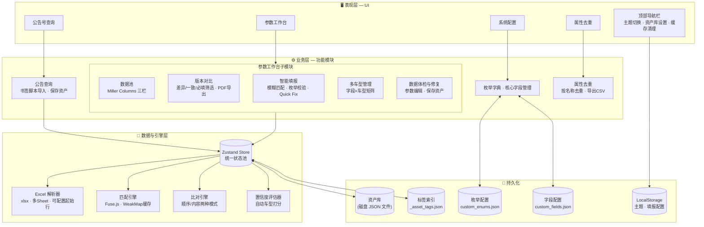
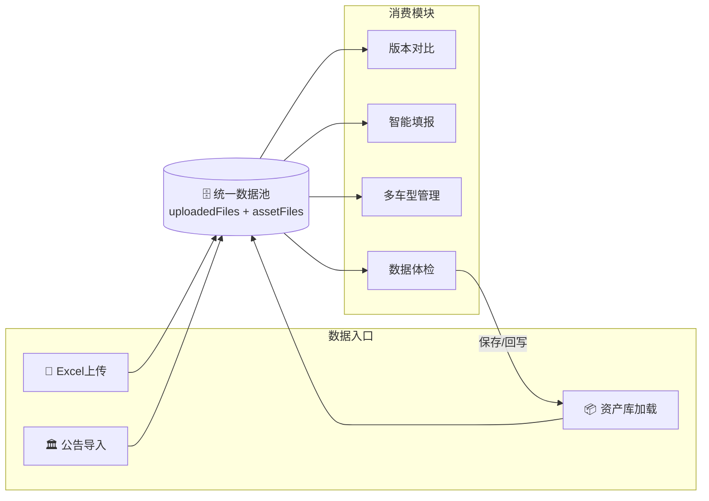
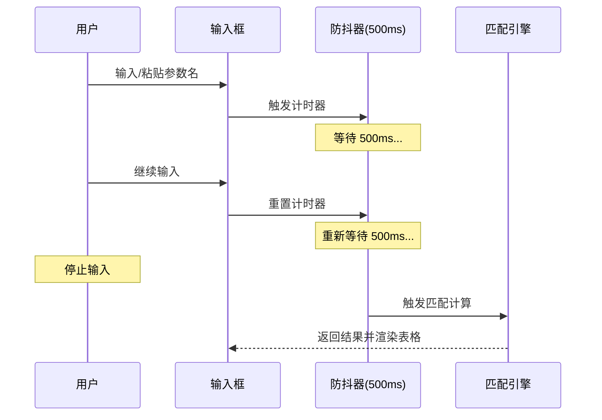
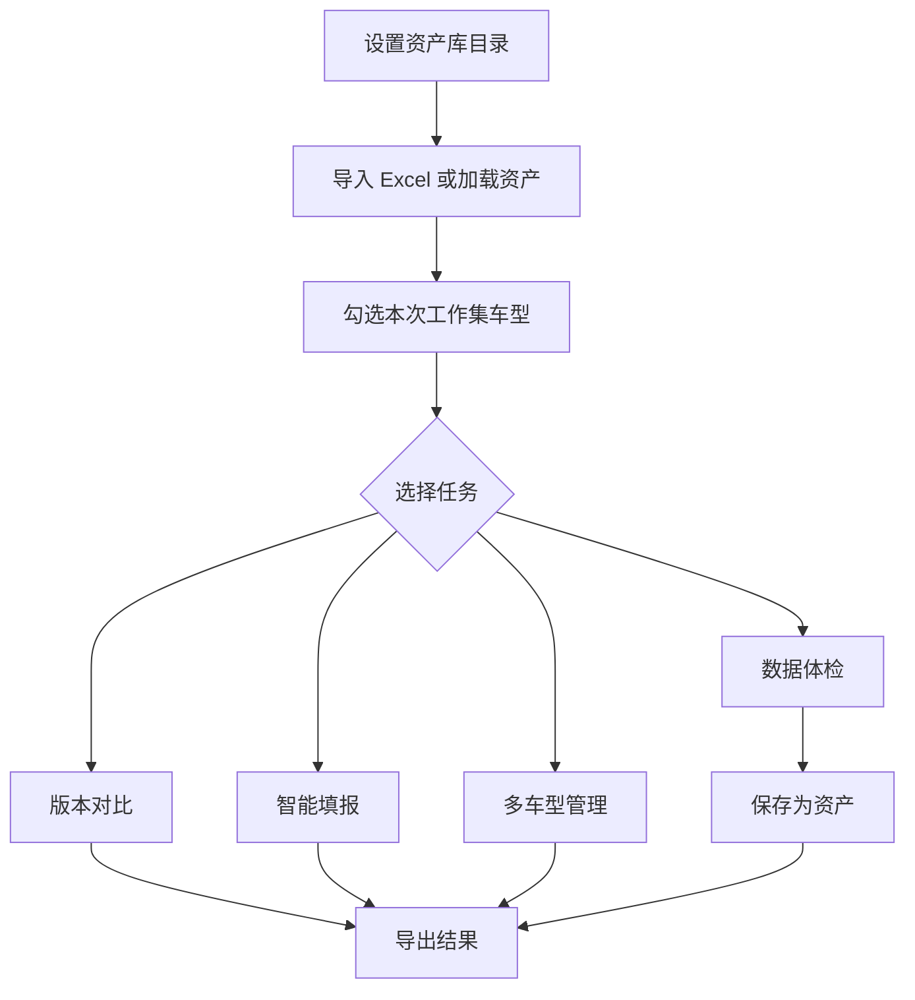

# 智行参数管理系统 - 精简版操作手册

版本：`v4.4.5`  
适用人群：一线业务、新上手同事、短时培训

---

## 1. 一句话定位

这是一个“把车型参数数据集中管理、快速比对、智能填报、资产沉淀”的工具，核心目标是减少 Excel 手工处理时间并降低错漏风险。

---

## 2. 系统架构

---

## 2.1 设计哲学

### 理念一：数据池中心化 — "一池多用"

> 所有数据（Excel 上传、公告导入、资产库加载）汇入统一数据池，各业务模块按需消费，避免数据孤岛。

### 理念二：Miller Columns 渐进聚焦 — "三栏漏斗"

> 数据池采用「数据源 → 车型列表 → 参数概览」三栏渐进式布局，每一栏都是对前一栏的筛选与细化，让用户从宏观到微观逐步锁定目标。

### 理念三：输入即触发 — "零按钮交互"

> 移除所有"开始匹配"按钮，采用 500ms 防抖机制：用户停止输入后自动计算结果，实现"键打停驻，结果自现"。

---

## 3. 标准流程图（你每天最常用）

---

## 4. 5 分钟上手

1. 右上角设置资产库目录。
2. 在“参数工作台 > 数据池”上传 Excel。
3. 在中间“车型大纲”勾选要分析的车型。
4. 进入你要的模块：
   1. 版本对比：看差异、导出 PDF。
   2. 智能填报：贴需求字段，自动给值。
   3. 多车型管理：同一字段跨车型汇总。
   4. 数据体检：修字段名/值并保存资产。

---

## 5. 各模块最短操作路径

## 5.1 数据池

说明：参数工作台内部已做紧凑化处理，默认会比旧版看到更多内容。

1. 添加文件。
2. 勾选车型进入工作集。
3. 点某车型查看右侧概览。
4. 若资产库中已有旧资产，且厂商给了新版 Excel，可在资产卡片点“升级导入”。
5. 数据池支持拖拽调整左右宽度，也支持调整左列上下区域高度。
6. 调整结果会自动记住；如想恢复初始布局，可点资产库区域里的“恢复布局”。
7. 资产重命名现在会同时更新文件名和车型名称，卡片标题不再显示 `.json`。
8. 资产筛选已拆成“来源 / 车型族群 / 厂商 / 其他标签”，其中车型族群和厂商是互斥单选，其他标签支持多选交集。

## 5.2 资产升级导入

1. 在数据池左下角资产库里找到目标资产。
2. 点击“升级导入”。
3. 上传新版 Excel。
4. 系统自动生成升级清单：
   1. 一致
   2. 新增字段
   3. 空值补全
   4. 冲突字段
   5. 仅旧资产存在
5. 先看“最终覆盖预览”摘要，再按需展开明细。
6. 可随时导出“升级审查 PDF”做留档或复核。
7. 只需要重点处理“冲突字段”。
8. 处理完后可：
   1. 另存为新版本
   2. 覆盖原资产
9. 升级保存后会自动带上 `资产升级`、`厂商更新` 标签。

## 5.3 版本对比

1. 进入“版本对比”。
2. 选择一个或多个车型。
3. 切换“差异/一致/必填”筛选。
4. 导出 PDF 报告。
5. 若发现资产库车型数据有问题，可直接点异常值进入体检页。

## 5.4 智能填报

1. 选参考车型。
2. 输入需求字段（每行一个）或从文件导入。
3. 自动生成匹配结果。
4. 修正低置信度项。
5. 导出 CSV。
6. 若遇到未匹配或枚举异常，可直接点异常值去修源数据。

## 5.5 多车型管理

1. 输入目标字段列表。
2. 多选车型。
3. 自动生成字段-车型矩阵。
4. 导出 CSV。
5. 若某车型字段缺失，且来源于资产库，可直接点异常值。

## 5.6 数据体检与修复

1. 选车型。
2. 修参数名、参数值、分组。
3. 用“异常”快捷筛选处理问题项。
4. 保存到资产库（覆盖或另存为）。
5. 如果是从其它分析页跳进来，顶部会显示当前修复任务并支持保存后返回。

## 5.7 公告号查询

1. 输入公告号并打开工信部页面。
2. 用书签脚本提取 JSON。
3. 粘贴导入系统。
4. 可设为比对目标或保存资产。

## 5.8 系统配置

1. 枚举字典：管理字段的标准可选值。
2. 核心字段：管理系统必填和质量验车字段。
3. 标签分组：管理“其他 / 车型族群 / 厂商”三类标签组。
4. 保存后立即生效。

## 5.9 属性去重

1. 上传属性池 Excel。
2. 自动按“属性名称”去重。
3. 导出两列 CSV（属性名称、是否必填）。

---

## 6. 常见问题（极简）

1. 上传失败：先看是否为 `.xlsx/.xls`，再尝试“重新配置解析”。
2. 匹配不准：优先使用系统标准字段，低置信度项手动修正。
3. 看不到资产：确认已设置资产库目录，且文件为有效 `.json` 资产。
4. 保存失败：检查目录写权限和文件名合法性。

---

## 7. 推荐命名规范

资产名建议：`车型_日期_版本`  
示例：`DNC5037_20260304_v2`
